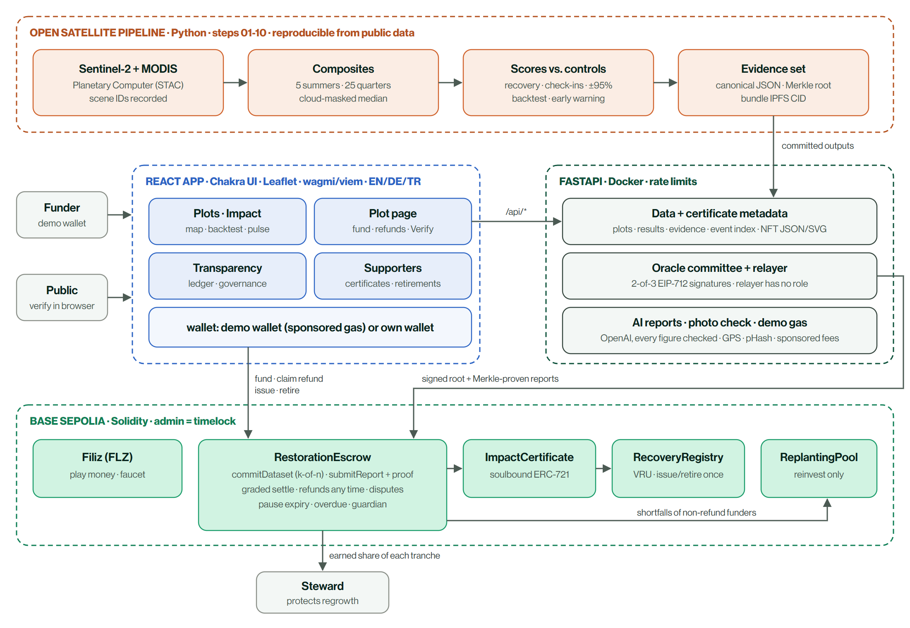

# ReGrow · from the ashes, verified

**Pay-for-results restoration of wildfire scars.** Funders lock money per burned 64 ha plot in a smart contract.
Sentinel-2 satellites measure every quarter and every summer whether the land is *actually recovering*, compared with
unburned control forest. An oracle committee commits each evidence set on-chain; the contract pays local stewards only
the share the evidence earns and refunds the rest immediately. Restored plots issue **Verified Recovery Units** that can
be retired exactly once.

Built for the **IEEE ClimateChain Global Hackathon 2026** · Track: **Carbon Markets & Emissions Transparency**
(secondary: Climate Data & Environmental Monitoring).

> Live app: [regrow.living](https://regrow.living) · Network: Base Sepolia (testnet, test money only)
> Whitepaper: [PDF](docs/ReGrow_Whitepaper.pdf) · [Markdown](docs/WHITEPAPER.md) · Threat model: [docs/SECURITY.md](docs/SECURITY.md) · Hard questions: [regrow.living/how-it-works](https://regrow.living/how-it-works#faq)



## Results on the 2021 Manavgat fire (real data, 2021-2026)

| | |
|---|---|
| Fire perimeter (Sentinel-2, 20 m) | **59,234 ha** vs 56,663 ha reported; vs NASA MODIS **IoU 0.89** |
| Backtest of the contract on every burned forest cell | **534 cells · 34,176 ha** |
| Paid to stewards on evidence / refunded | **87.5% / 12.5%** |
| Eventual failures flagged by year-one quarterly check-ins | **56%**, 1-4 years before the final verdict |
| Failure rate after post-fire damage vs untouched slopes | **67.6% vs 8.0% (8.5×)** |
| Early warning from data available by end of 2022 | ROC-AUC **0.97** (one-variable baseline 0.98: the signal is robust) |
| Matched controls: covariate balance after matching | all \|SMD\| ≤ 0.11 (before: up to 1.19) |
| Placebo: healthy forest falsely flagged as damaged | **0.34%** (6 of 1,760 cells) |
| Hansen/UMD forest loss 2021 inside our perimeter · lost share by severity | **94%** · 1% unburned to 84% high |
| Damage signal vs real clearings (Hansen 2022-2025, unburned forest) | ROC-AUC **0.95** |
| Later loss of surviving trees: check-in flagged vs passed | **20.9 vs 5.7 ha** per cell (AUC 0.88) |
| Recovery re-measured with Landsat 8/9 vs Sentinel-2 (2026) | r = **0.993**, same pass/fail for **96.8%** of cells |

## How it works

0. **Open:** the forest authority (OGM in Türkiye, which owns state forest land) opens a plot and approves its steward
   and restoration method. OGM is the intended partner; no partnership exists yet, so a test account holds this role.
1. **Fund:** funders lock FLZ for a plot (demo wallet, no crypto needed) and receive a soulbound impact certificate.
2. **Measure:** the open pipeline computes recovery vs unburned controls every quarter and every summer, with
   uncertainty and the Sentinel-2 scene IDs behind every number.
3. **Commit:** an oracle committee (2 of 3, EIP-712) signs the Merkle root of all findings plus the IPFS CID of the
   evidence bundle. Anyone can then submit a report with a Merkle proof.
4. **Settle:** schedule **15% start · 4 × 5% quarterly check-ins · 30% early recovery (2023) · 35% sustained recovery
   (2026)**. The steward earns `min(score/target, 1)` of each tranche; the shortfall is refunded at once. Below half the
   target the plot fails and all unreleased funds are refunded. Reports can be challenged with a bond.
5. **Protect:** a committed disturbance finding pauses payouts. The forest authority and an independent reviewer
   decide (approved works resume payouts); after 30 days without a decision anyone can expire the pause and open refunds. Overdue reports also open refunds.
6. **Claim impact:** restored plots issue Verified Recovery Units (area × verified score, 20% buffer), pro-rata to
   funders, non-transferable, retire-once with a public beneficiary and purpose.

**Why blockchain:** the escrow enforces payout rules without a middleman; every score is bound to a signed, public
evidence commitment; impact claims exist once and are retired once, in public. **Trust model:** no single key can
decide a payout (oracle committee), change a committed score (Merkle proofs), or change the rules instantly (admin is a
TimelockController; parameters bounded; deployer renounces admin; replanting pool can only reinvest).

## Verify a result yourself

In the app, press **Verify** on any milestone: your browser downloads the evidence file, hashes it, rebuilds the Merkle
leaf, folds the proof to the committed root and reads the on-chain report. Or from a shell:

```bash
curl -O <app>/api/data/evidence/plot-r41c21-m6.json
cast keccak "$(cat plot-r41c21-m6.json)"     # = evidenceHash in MilestoneReported(plotId 1, idx 6)
```

## AI, advisory and checked

- **Progress report per plot** (English, German, Turkish): written by a language model only from the plot's facts
  sheet, the same numbers the evidence commits to. Every number in the text must appear in the facts, otherwise the
  model gets one retry and unverified text is never published (`pipeline/15_ai_reports.py`).
- **Ask the evidence:** visitors ask questions about a plot on its page; answers use the same facts and the same number
  check, ignore instructions hidden in the question, are rate-limited and cached.
- **Steward photo check:** a vision model takes an advisory look at the content; the hard checks (GPS inside the plot,
  date after the fire, not reused) decide.
- **Early warning:** a gradient-boosting model ranks slopes by failure risk from data available by end of 2022.

The AI never decides a payout. Every call is logged with its estimated cost, and visitor calls stop at a daily budget
(`AI_DAILY_BUDGET_USD`, `GET /api/ai/status`); the site keeps working without them.

## Satellite method

| Step | Detail |
|---|---|
| Data | Sentinel-2 L2A (Microsoft Planetary Computer), 20 m annual and 60 m quarterly composites, SCL cloud mask, median; baseline-04.00 offset corrected |
| Indices | NBR, NDVI, dNBR; Key & Benson severity classes |
| Recovery | `adj = RR − (NBR_ctrl,t − NBR_ctrl,pre)/(NBR_pre − NBR_post)` with three unburned control cells (drift ≤ 0.035 NBR) |
| Check-ins | Net NBR drop vs previous quarter, controls subtracted, threshold 0.10 (healthy −0.13…+0.03, damaged +0.12…+0.20) |
| Uncertainty | Per-pixel spread, 95% interval (n_eff = n/9), margin to target in every evidence file |
| Validation | Perimeter vs NASA MODIS MCD64A1 on a 500 m grid: IoU 0.89, 94%/95% mutual agreement |

## Contracts (Solidity 0.8.30 · OpenZeppelin 5.7 · Foundry)

| Contract | Role | Address (Base Sepolia) |
|---|---|---|
| `RestorationEscrow` | plots, committee-committed datasets, Merkle-proven reports, graded settlement, refunds, disputes, pauses | [`0x60EC…eba1`](https://sepolia.basescan.org/address/0x60ECDc95624841ba339E99662735B80915e2eba1) |
| `RecoveryRegistry` | Verified Recovery Units: issue once, 20% buffer, retire once | [`0xC410…20fe`](https://sepolia.basescan.org/address/0xC4106404F625e15517B7a4d07C680B6500E720fe) |
| `ImpactCertificate` | soulbound ERC-721, metadata from live escrow state | [`0x0b7E…fB93`](https://sepolia.basescan.org/address/0x0b7EAED1528D7873600D8Ea9E4f7131E8c5CfB93) |
| `ReplantingPool` | receives non-refund shortfalls; can only reinvest into plots | [`0xb8a8…83Bd`](https://sepolia.basescan.org/address/0xb8a8761852EBf406F9FCD175C5196E96268B83Bd) |
| `TimelockController` | holds admin; every role or rule change is delayed and public | [`0x428C…8235`](https://sepolia.basescan.org/address/0x428C88fDf280Ad92836a881D093077543d6C8235) |
| `Filiz` | FLZ play money (1 FLZ = one test dollar) with faucet; "filiz" is Turkish for a young sprout | [`0x87B6…F430`](https://sepolia.basescan.org/address/0x87B6Cb7071b790b4827b39C4097376D5406BF430) |

45 Foundry tests: adversarial unit tests (signature replay and malleability, wrong proofs, window and pause
boundaries, double claims, soulbound transfers), a conservation fuzz test and a stateful invariant suite (no funder ever
gets back more than they deposited, exact token conservation, one-time issuance). Invariant testing found four real
bugs, all fixed with regression tests; see [docs/SECURITY.md](docs/SECURITY.md).

## Repository

```
contracts/   Foundry: src/, test/, script/Deploy.s.sol, install-deps.sh, export-abis.sh
backend/     FastAPI (src/regrow_api) · pipeline 01-10 · committed outputs (data/: plots, results, evidence, dataset, backtest)
app/         React + Vite + TypeScript · Chakra UI v3 · Leaflet · Recharts · wagmi/viem + RainbowKit · e2e/ (Playwright)
deploy/      docker compose + Caddy (HTTPS, security headers) for one VPS
docs/        WHITEPAPER (+ PDF), SECURITY (threat model), architecture diagram
scripts/     local-demo.sh: private chain + API + app in one command; whitepaper_pdf.py: the PDF
```

## Run it locally

Requirements: Node 22+ with pnpm, Python 3.13 with [uv](https://docs.astral.sh/uv/), [Foundry](https://getfoundry.sh).

```bash
cd contracts && ./install-deps.sh && forge test && cd ..
./scripts/local-demo.sh --reset        # private chain + contracts + API + app → http://localhost:5173 (admin: regrow-local)
cd backend && uv sync && uv run pytest  # API tests incl. evidence-hash integrity
```

Regenerate all satellite results (downloads from Planetary Computer):

```bash
cd backend && uv sync --group pipeline
uv run python pipeline/01_fetch_composites.py && uv run python pipeline/02_burn_map.py
uv run python pipeline/03_cells.py && uv run python pipeline/04_select_and_score.py
uv run python pipeline/05_thumbnails.py && uv run python pipeline/06_pulse.py && uv run python pipeline/06_pulse.py --cells
uv run python pipeline/07_milestones.py && uv run python pipeline/08_backtest.py
uv run python pipeline/09_dataset.py && uv run python pipeline/10_validate.py
uv run python pipeline/15_ai_reports.py --model=gpt-5   # optional: AI progress reports (needs an API key)
```

## Roadmap

Independent oracle organisations and community auditors · vision model classifying damage type, hashed into evidence ·
multi-party IPFS pinning · account abstraction instead of a fee faucet · pilots with OGM (General Directorate of
Forestry) and coastal municipalities · tourism funding · other fire scars · biomass models for carbon estimates.

## Image credits

- Landing-page time-lapse and plot imagery: contains modified Copernicus Sentinel data 2021-2026 (ESA), via Microsoft
  Planetary Computer, processed by the ReGrow pipeline.

## Sources

- Burned areas: Gebze Technical University mapping via [Bianet, 12 Aug 2021](https://bianet.org/english/environment/248673-study-83-000-hectares-of-forests-burned-in-turkey-s-south-and-southwest-in-two-weeks)
- Tavşanoğlu & Pausas (2022), *Science*: [post-fire policy in Türkiye](https://www.uv.es/jgpausas/papers/Tavsanoglu-Pausas-2022_Science_Turkish-postfire.pdf)
- Sentinel-2 L2A and MODIS MCD64A1 via [Microsoft Planetary Computer](https://planetarycomputer.microsoft.com/) (contains modified Copernicus Sentinel data 2021-2026)
- Basemap imagery © Esri, Maxar, Earthstar Geographics · place names © OpenStreetMap contributors

## Licence

MIT
